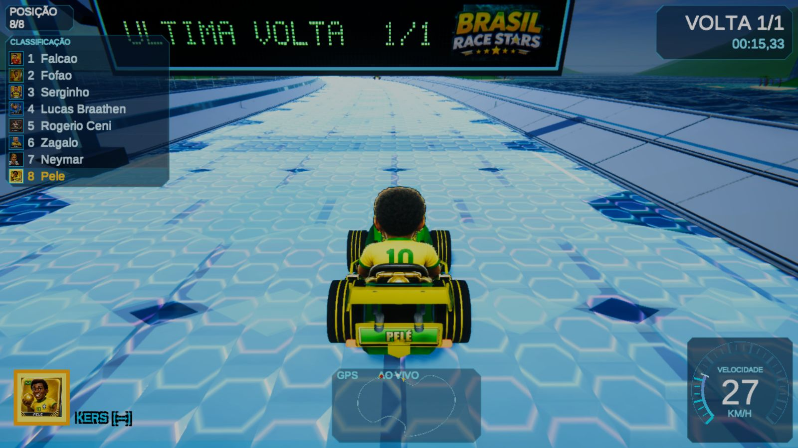

# Brasil Race Stars — instalar e jogar com amigos

Os instaladores públicos atuais são da versão **1.0.1**, publicada em 25/10/2026. Windows, Android e Meta Quest usam a mesma versão para entrar juntos na sala online.

**As correções 1.0.2 ainda estão em desenvolvimento e teste. Não há instalador 1.0.2 publicado. A 1.0.1 pode apresentar os problemas de jogabilidade já relatados; os links abaixo não representam a conclusão dessas correções.**

| Aparelho | Download 1.0.1 | Tamanho aproximado |
|---|---|---|
| PC Windows 64 bits | [Instalador Windows](https://github.com/ricardofilhorh-rgb/brasil-race-stars-downloads/releases/download/v1.0.1/BrasilRaceStars-1.0.1-Windows-Instalador.exe) | 1,82 GB |
| Celular / tablet / TV box Android compatível | [APK Android](https://github.com/ricardofilhorh-rgb/brasil-race-stars-downloads/releases/download/v1.0.1/BrasilRaceStars-1.0.1-movel.apk) | 1,77 GB |
| Meta Quest 2 / 3 / 3S | [APK Quest VR](https://github.com/ricardofilhorh-rgb/brasil-race-stars-downloads/releases/download/v1.0.1/BrasilRaceStars-1.0.1-quest.apk) | 1,68 GB |

[Versão pública mais recente](https://github.com/ricardofilhorh-rgb/brasil-race-stars-downloads/releases/latest) · [Notas da 1.0.1](https://github.com/ricardofilhorh-rgb/brasil-race-stars-downloads/releases/tag/v1.0.1) · [SHA-256 dos arquivos](https://github.com/ricardofilhorh-rgb/brasil-race-stars-downloads/releases/download/v1.0.1/SHA256SUMS-1.0.1.txt)

## Instalar ou atualizar

- **Windows:** baixe o `.exe`, abra e siga o assistente. Use o mesmo destino da instalação anterior para atualizar. Os dados do jogador ficam preservados.
- **Android:** baixe o APK móvel no aparelho e abra. Autorize a instalação desta fonte quando o Android pedir. Instale por cima da versão anterior; não desinstale antes. O pacote móvel suporta Android 7 ou posterior, em aparelhos ARM compatíveis. Celular tem controles na tela; TV box requer controle e Android compatível.
- **Meta Quest:** use o APK Quest VR, pelo SideQuest ou ADB, com modo desenvolvedor e conexão USB autorizados. Atualize por cima do mesmo pacote. Não use o APK móvel como substituto do APK VR.

Não há instaladores nativos para iPhone/iPad, macOS ou Linux nesta entrega. O APK não é um instalador universal para qualquer Smart TV.

## Entrar na mesma sala online

1. Todos conferem **1.0.1** no jogo. Instalações com versões diferentes não devem ser misturadas na sala.
2. Um jogador abre **ONLINE → CRIAR SALA** e envia o código aos amigos.
3. Os outros abrem **ONLINE → ENTRAR NA SALA**, digitam o código e escolhem o piloto.
4. Todos marcam **ESTOU PRONTO**. O anfitrião inicia a partida.
5. Ao terminar, use **VOLTAR À SALA** para organizar outra partida.

Os links e as somas dos três instaladores foram conferidos em 27/10/2026, com acesso sem login. Isso verifica disponibilidade e integridade dos arquivos, não comprova que todos os problemas do jogo foram resolvidos.

## Versão Web anterior

[Jogar no navegador](https://ricardofilhorh-rgb.github.io/brasil-race-stars-downloads/) é uma distribuição separada e anterior. A evidência histórica desta página é da versão 0.9.4/R9, com 20 pistas e seis arenas. Não a use como substituta dos instaladores 1.0.1 para formar a sala deste grupo. Não houve nova validação do jogo Web nesta atualização da documentação.

O teste histórico Web cobriu solo e dois clientes online, Pelé e Neymar, mais seis IA, com teclado e regras do anfitrião recebidas pelo convidado. Não comprova oito clientes de rede, todos os ciclos dos modos ou controles físicos USB/Bluetooth.

## CDs digitais do Ricardo

- [Músicas cristãs — 37 faixas](https://musicas-cristas-ricardo.netlify.app/): catálogo cristão. Para adicionar ao celular, use a opção de instalação/adicionar à tela inicial do navegador. O ícone é a capa com escadaria, nuvens e luz.
- [Criatividade / músicas variadas — 16 faixas](https://musicas-variadas-ricardo.netlify.app/): catálogo variado. A instalação pelo navegador usa a capa com retrato de regata e boné, de braços abertos.

As quantidades são as exibidas nos catálogos anteriormente conferidos. Existe outro atalho cristão no celular cuja edição ainda não foi comparada. Instalação nova e reprodução offline de todas as faixas não foram validadas nesta atualização.
