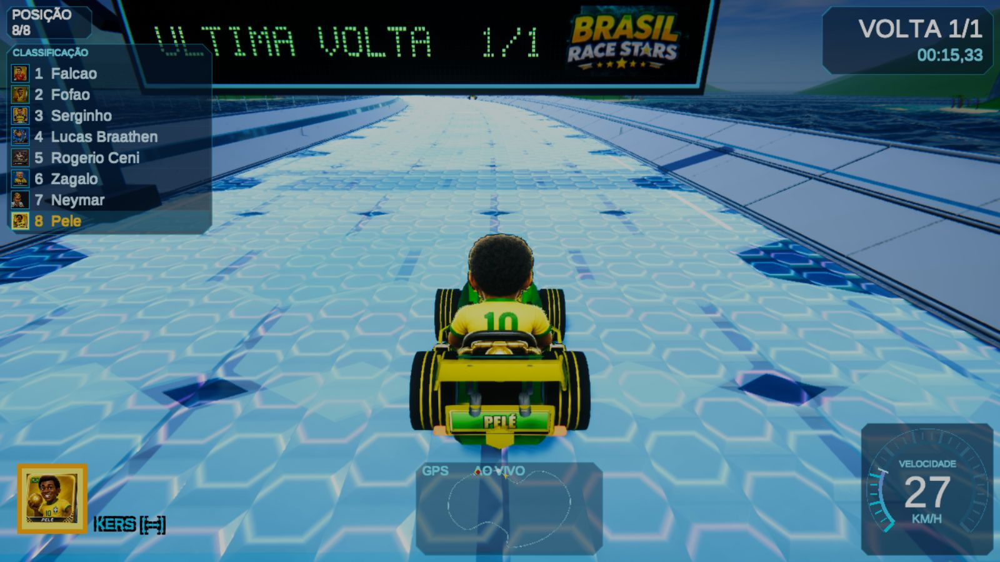

# Brasil Race Stars — instalar e jogar com amigos

Versão pública **1.0.2**, atualizada em **08/11/2026**, para Windows, Android e Meta Quest. Todos devem usar a mesma versão para entrar juntos na sala online.

Cristiano Ronaldo, Messi e Maradona com cards premium, pilotos 3D, bandeirões, mosaicos e narração; Cristiano com “Siuuu!” e “Eu estou aqui!”. Inclui Bolsonaro novo, rostos melhorados e correções de malha para fechar furos em 86 pilotos.

| Aparelho | Download 1.0.2 | Tamanho | Link curto |
|---|---|---|---|
| PC Windows 64 bits | [Instalador Windows](https://github.com/ricardofilhorh-rgb/brasil-race-stars-downloads/releases/download/v1.0.2/BrasilRaceStars-1.0.2-Windows-Instalador.exe?brs=1794135842327) | 1,63 GB | [brsjogopc](https://tinyurl.com/brsjogopc) |
| Celular / tablet / TV box Android compatível | [APK Android](https://github.com/ricardofilhorh-rgb/brasil-race-stars-downloads/releases/download/v1.0.2/BrasilRaceStars-1.0.2-movel.apk?brs=1794135842333) | 1,71 GB | [brscel](https://tinyurl.com/brscel) |
| Meta Quest 2 / 3 / 3S | [APK Quest VR](https://github.com/ricardofilhorh-rgb/brasil-race-stars-downloads/releases/download/v1.0.2/BrasilRaceStars-1.0.2-quest.apk?brs=1794135842332) | 1,62 GB | [brsquest](https://tinyurl.com/brsquest) |

[Versão pública mais recente](https://github.com/ricardofilhorh-rgb/brasil-race-stars-downloads/releases/latest) · [Notas da 1.0.2](https://github.com/ricardofilhorh-rgb/brasil-race-stars-downloads/releases/tag/v1.0.2) · [SHA-256 dos arquivos](https://github.com/ricardofilhorh-rgb/brasil-race-stars-downloads/releases/download/v1.0.2/SHA256SUMS.txt?brs=1794135998188)

## Instalar ou atualizar

- **Windows:** baixe o `.exe`, abra e siga o assistente. Use o mesmo destino da instalação anterior para atualizar. Os dados do jogador ficam preservados.
- **Android:** baixe o APK móvel no aparelho e abra. Autorize a instalação desta fonte quando o Android pedir. Instale por cima da versão anterior; não desinstale antes. O pacote móvel suporta Android 7 ou posterior, em aparelhos ARM compatíveis. Celular tem controles na tela; TV box requer controle e Android compatível.
- **Meta Quest:** use o APK Quest VR, pelo SideQuest ou ADB, com modo desenvolvedor e conexão USB autorizados. Atualize por cima do mesmo pacote. Não use o APK móvel como substituto do APK VR.

Não há instaladores nativos para iPhone/iPad, macOS ou Linux nesta entrega. O APK não é um instalador universal para qualquer Smart TV.

## Entrar na mesma sala online

1. Todos conferem **1.0.2** no jogo. Instalações com versões diferentes não devem ser misturadas na sala.
2. Um jogador abre **ONLINE → CRIAR SALA** e envia o código aos amigos.
3. Os outros abrem **ONLINE → ENTRAR NA SALA**, digitam o código e escolhem o piloto.
4. Todos marcam **ESTOU PRONTO**. O anfitrião inicia a partida.
5. Ao terminar, use **VOLTAR À SALA** para organizar outra partida.

Os links públicos e os hashes SHA-256 dos três pacotes foram conferidos em 08/11/2026: intervalos baixados sem login coincidiram com os arquivos locais, e o SHA-256 completo registrado pelo GitHub corresponde ao de cada pacote. Essa verificação não equivale a teste completo de todos os modos e aparelhos.

## Versão Web anterior

[Jogar no navegador](https://ricardofilhorh-rgb.github.io/brasil-race-stars-downloads/) é uma distribuição separada e anterior. A evidência histórica desta página é da versão 0.9.4/R9, com 20 pistas e seis arenas. Não a use como substituta dos instaladores 1.0.2 para formar a sala deste grupo. Não houve nova validação do jogo Web nesta atualização da documentação.

O teste histórico Web cobriu solo e dois clientes online, Pelé e Neymar, mais seis IA, com teclado e regras do anfitrião recebidas pelo convidado. Não comprova oito clientes de rede, todos os ciclos dos modos ou controles físicos USB/Bluetooth.

## CDs digitais do Ricardo

- [Músicas cristãs — 37 faixas](https://musicas-cristas-ricardo.netlify.app/): catálogo cristão. Para adicionar ao celular, use a opção de instalação/adicionar à tela inicial do navegador. O ícone é a capa com escadaria, nuvens e luz.
- [Criatividade / músicas variadas — 16 faixas](https://musicas-variadas-ricardo.netlify.app/): catálogo variado. A instalação pelo navegador usa a capa com retrato de regata e boné, de braços abertos.

As quantidades são as exibidas nos catálogos anteriormente conferidos. Existe outro atalho cristão no celular cuja edição ainda não foi comparada. Instalação nova e reprodução offline de todas as faixas não foram validadas nesta atualização.
